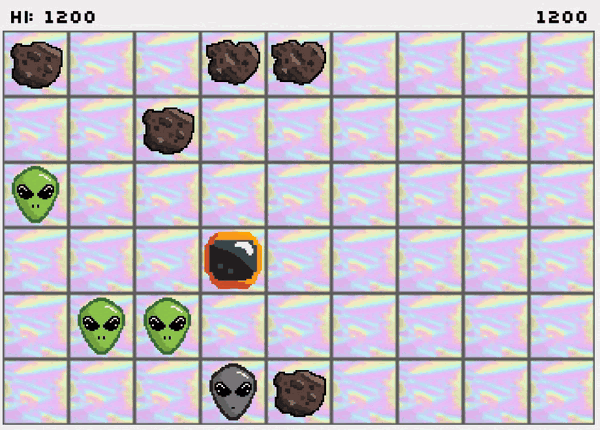
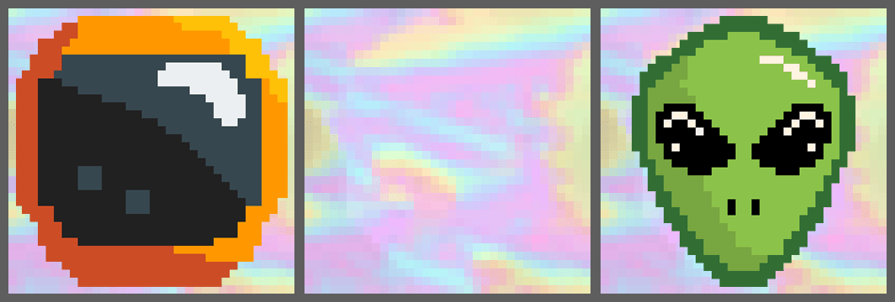
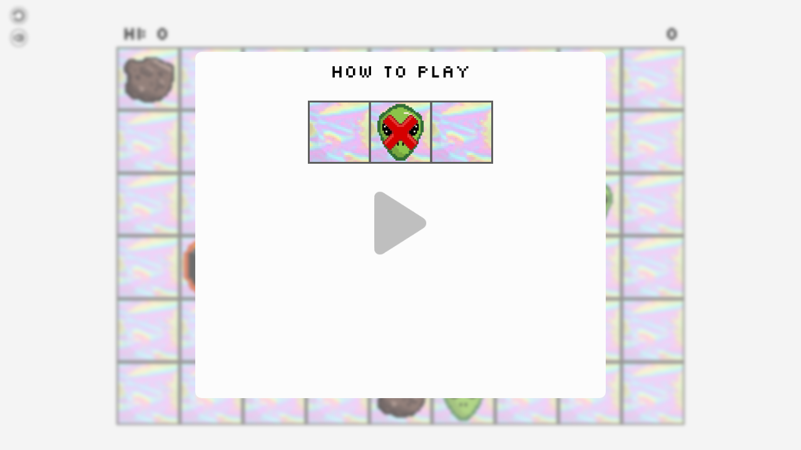
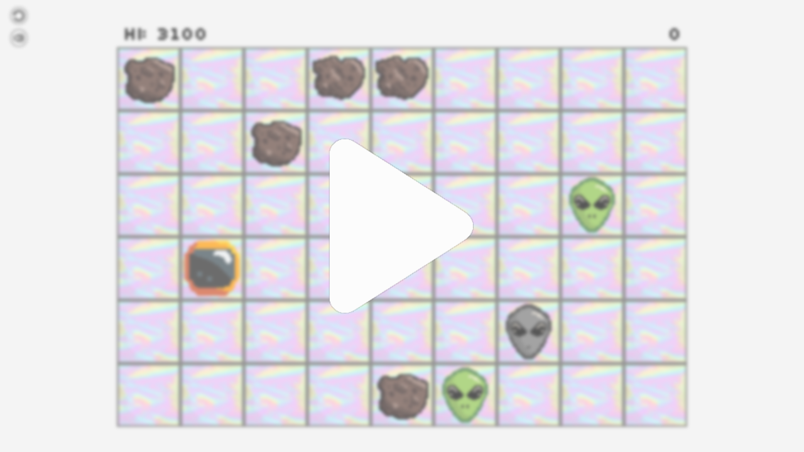
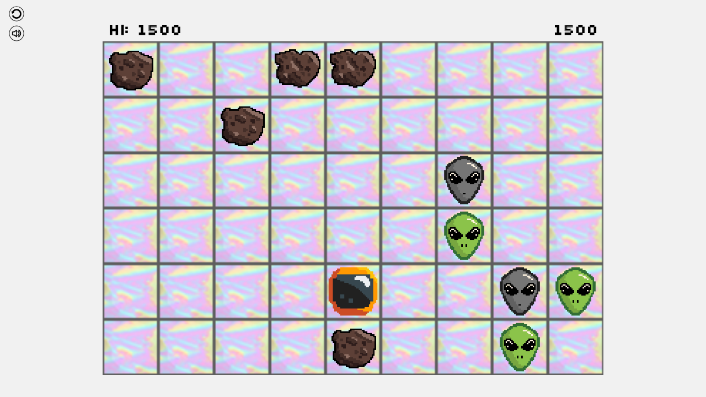
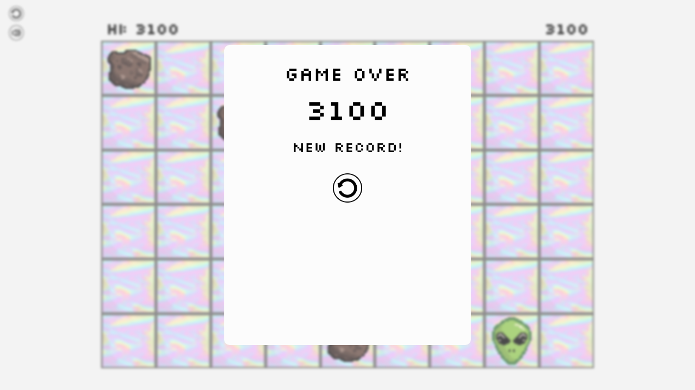

# Swipt 👽

A tiny turn-based pixel-art arcade game: you are an astronaut on a 9 × 6 board,
and the goal is to **eat the aliens before they eat you**.

### ▶️ [Play it in your browser](https://gkhnkrhn.github.io/swipt/)

No install, no build step. It's plain HTML, CSS and JavaScript.

<p align="center">
  
</p>

## The story

I wrote Swipt in 2020, during the pandemic. I had just started university, the
English prep year was fully online, and I was bored. So I made a game.

The whole game is hand-written HTML, CSS and vanilla JavaScript, typed out in
**Notepad++**. There are no frameworks, no game engine and no libraries.

All the pixel art (the astronaut, the aliens, the asteroids, the board tiles and
the buttons) was drawn by my sister, **Damla Karahanoğulları**. Thank you, abla! 💜

Later I wrapped the game in a small Android WebView app, and for a while
**Swipt was on Google Play**. I didn't push updates for a long time, so Google
eventually closed my developer account and the game disappeared from the store.
Maybe I'll publish it again one day. Until then, it lives here.

## How to play

<p align="center">
  
</p>

The game is turn-based. Every time you move, the aliens move too.

- **Move:** arrow keys or <kbd>W</kbd> <kbd>A</kbd> <kbd>S</kbd> <kbd>D</kbd> on a
  keyboard. On a touchscreen, swipe (that's where the name comes from).
- **Eat an alien:** step onto an alien that is right next to you. Aliens don't get
  to move on a turn when you eat.
- **Don't get eaten:** if *you* end your move next to an alien, it jumps on you.
  Game over.
- **Asteroids** block the way for you and for the aliens.
- **Combo:** each alien is worth 100 × your current streak. Eat aliens on
  back-to-back moves and you get 100, 200, 300, … points. Any move without eating
  resets the streak.
- A new alien appears every 4–7 moves, so the board keeps getting busier.
- Your high score and your mute setting are saved in the browser (`localStorage`).

It's best played in **landscape** (the Android app was locked to landscape). On a
phone, rotate it sideways.

## Screenshots

| First launch | Returning player |
|:---:|:---:|
|  |  |
| **In game** | **Game over** |
|  |  |

## Run it locally

Clone the repo and open `index.html` in a browser. To avoid browser quirks with
`file://` URLs, you can serve the folder over HTTP instead:

```bash
python -m http.server 8000
# then open http://localhost:8000
```

## Repository layout

```
index.html            the game page
css/main.css          layout and styling (+ slkscr.ttf, the Silkscreen pixel font)
js/main.js            start/reset/game-over flow, keyboard and swipe input
js/map.js             the 9×6 board: creating cells, placing and finding objects
js/move.js            player moves, scoring and combos, alien AI
js/sound.js           sound effects and the mute button
img/                  pixel art by Damla Karahanoğulları
                      (*a.png files are earlier sprite versions, not used by the game)
sound/                sound effects
android/              Android Studio project: a WebView wrapper used for the Play Store release
screenshots/          screenshots and the gameplay GIF for this README
licenses/             third-party licenses
```

### The Android app

`android/` is the app that was published on Google Play. It is a single
fullscreen, landscape `WebView` that loads the game from
`app/src/main/assets/www/`, a copy of the web version, with an AdMob banner on top.

It was built with Android Studio in 2021 (Android Gradle Plugin 4.1.3, `compileSdk 30`).
A current Android Studio will probably ask you to upgrade Gradle before it builds.
The release signing key is not part of this repository.

## A few Turkish words in the code

Some identifiers are in Turkish:

| In the code | Meaning |
|---|---|
| `karakter` | character (the player, the astronaut) |
| `dusman` | enemy (an alien) |
| `engel` | obstacle (an asteroid) |
| `zemin` | floor (board tile) |
| `adet` | count |
| `doluMu` | "is it occupied?" |
| `engelVarMi`, `dusmanVarMi`, `karakterVarMi` | "is there an obstacle / enemy / character?" |
| `nereden`, `nereye` | from where, to where |
| `hucre` | cell |

## Credits & license

- **Code:** © 2020 Gökhan Karahanoğulları, released under the [MIT License](LICENSE).
- **Pixel art** (everything in `img/`, and the app icon): drawn by **Damla
  Karahanoğulları**. The art is **not** covered by the MIT license; please ask
  before reusing it.
- **Font:** [Silkscreen](http://www.kottke.org/plus/type/silkscreen/) by Jason Kottke.
  It is redistributed unmodified, as its [license](licenses/Silkscreen-License.txt) allows.
